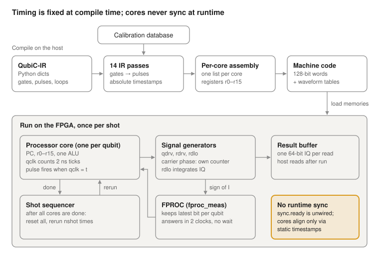

# QubiC Compiler & ISA Reference

October 22, 2026

QubiC compiles a list of Python-dict IR instructions into one statically timed
instruction stream per processor core; every pulse carries an absolute clock
timestamp, and cores stay aligned only through that static schedule. This
reference traces the path from IR to 128-bit machine words, checked against the
compiler, the assembler and the processor RTL.

## How to read this

Every technical claim carries a tag saying where it comes from. Paths are
relative to `distributed_processor/python/` unless they start with another repo
directory.

| Tag | Meaning |
| --- | --- |
| **\[code\]** | Read in the Python compiler/assembler source, or observed in a compiler run |
| **\[HDL\]** | Read in the processor RTL (`distributed_processor/hdl/`) |
| **\[sim\]** | Observed in a cycle-accurate Verilator simulation of that RTL |
| **\[gen\]** | Read in the gateware build generator (`gateware/top/src/`), which emits the Verilog that is synthesized |
| **\[doc\]** | Stated only in the documentation (`distributed_processor/python/docs/`) |
| **\[interp\]** | My interpretation or design suggestion |
| **\[unclear\]** | Not verified, or looks wrong |

**What was examined:** unmodified copies of the QubiC sources, vendored in
`~/git/qubic-notes/vendor/`: `distributed_processor` (complete: compiler,
assembler, RTL; package version 25.08.0), `qubitconfig`, the used and cited
parts of `software` and `gateware`, and three modules of `common-hdl`.
`vendor/MANIFEST.md` records each origin and commit. Every source path in this
document resolves inside `vendor/`; nothing outside `qubic-notes` is needed, and
nothing is fetched.

**How listings were produced:** all IR, assembly and machine-code listings come
from real runs of the toolchain without hardware. The same stages are run as in
`software/qubic/toolchain.py:11-94`: `get_passes` → `Compiler.compile()` →
`GlobalAssembler` with `RFSoCElementCfg`,
`software/examples/channel_config.json` and `software/examples/qubitcfg.json`.
The setup script installs build copies of these packages into the project's
virtualenv. The instruction decoder that prints the right-hand column of the
machine-code listings is my own, written from the bit layout in
`command_gen.py`. RTL checks use my own cocotb 2.1 testbench on Verilator 5.052
against `sim_modules/toplevel_sim.sv`.

## At a glance



The compiler fixes every pulse's clock timestamp before anything runs; at
runtime each core only waits for its clock to reach those timestamps, and
measurement results return to the cores through FPROC.

## QubiC-IR operations

The IR is a list of Python dicts; `name` selects a class in
`distproc/ir/instructions.py` by CamelCase conversion, and **any unknown name
silently becomes a `Gate`** to be looked up in the calibration database
(`ir.py:263-290`) \[code\]. There is no `read` class: measurement is the gate
`read`. The QD column shows how QD (see QD prototype) writes each operation;
"not in QD v0" marks IR features QD does not expose.

**Variables and arithmetic**

| IR op | Key parameters | Lowers to (asm) | QD | Source |
| --- | --- | --- | --- | --- |
| `declare` | `var`, `scope`, `dtype` ∈ {int, phase, amp} | `declare_reg` on every core in scope | `a : amp;` | `instructions.py:478-487`, `compiler.py:232-234` |
| `set_var` | `var`, `value` | `reg_alu in0=imm id0` | `a = 0.1;` | `instructions.py:515`, `compiler.py:251-254` |
| `alu` | `op` ∈ {add, sub, eq, le, ge, id0, id1, zero}; `lhs` imm or var; `rhs` var only; `out` | `reg_alu` computing `lhs op rhs` | `a = a + 0.1;` | `instructions.py:499`, `compiler.py:246-249` |
| `bind_phase` | `var`, `qubit`/`freq` | `set_var 0`; later virtual-Z on that frame → `alu add`; pulses on it use the register as phase | not in QD v0 | `passes.py:568-594` |
| `declare_freq` | `freq`, `freqname`, `freq_ind`, `scope` | registers the frequency; with `freq_ind` an asm `declare_freq` (no machine word) | `F0 : freq : 4.94 GHz;` (no table index) | `compiler.py:236-244`, `assembler.py:199` |

**Control flow**

| IR op | Key parameters | Lowers to (asm) | QD | Source |
| --- | --- | --- | --- | --- |
| `loop` | `cond_lhs` imm/var, `alu_cond`, `cond_rhs` var, `body`, `scope` | `jump_label; barrier; body; loop_end → inc_qclk(−Δt); jump_cond` — a **do-while** | `do { X90(Q0); } while a < 1.0;` | `passes.py:110-121`, `compiler.py:279-281` |
| `branch_var` | `cond_lhs`, `alu_cond`, `cond_rhs`, `true`, `false` | `jump_cond`, false block, `jump_i`, true block | `if n == 10 { X90(Q0); } else { X90(Q1); }` | `passes.py:73-108` |
| `branch_fproc` | `cond_lhs`, `alu_cond`, `func_id`, `true`, `false` | `hold`→`idle`, `jump_fproc`, blocks as above | `if measure(Q0) == 1 { X90(Q0); }` | `passes.py:73-108, 721-730` |
| `jump_cond`, `jump_fproc`, `jump_i`, `jump_label` | low-level forms, also accepted as input | 1:1 | internal | `instructions.py:343-476` |
| `block` | `body`, `scope` | forces a basic-block boundary with explicit scope | not in QD v0 (scopes are inferred) | `passes.py:127-131, 189-198` |
| `halt` | `scope` | `done_stb` | not in QD v0 | `compiler.py:287-289` |

**Timing**

| IR op | Key parameters | Lowers to (asm) | QD | Source |
| --- | --- | --- | --- | --- |
| `delay` | `t` in seconds, compile-time constant; `qubit`/`scope` | removed by the scheduler (advances the channel cursor); unscoped = every channel of the program | `delay(500 us, Q0);` | `passes.py:317-324, 1141-1145` |
| `barrier` | `qubit`/`scope` | removed; aligns the cursors of all channels in scope | `barrier(Q0, Q1);` | `passes.py:1132-1139` |
| `idle` | `end_time` (absolute clocks) | `idle` | — | `compiler.py:283-285` |
| `hold` | `nclks`, `ref_chans` | `idle`; inserted automatically before every FPROC read | implicit | `instructions.py:307`, `passes.py:1171-1187` |
| `start_time` field | on `pulse`/gate | manual timestamp when scheduling is off (`LintSchedule` checks it) | not in QD v0 (`;` and `par` order statements) | `passes.py:1036-1056` |

**Pulses, frames and measurement**

| IR op | Key parameters | Lowers to (asm) | QD | Source |
| --- | --- | --- | --- | --- |
| `pulse` | `freq` (Hz, name or int var), `phase` (rad or var), `amp` (or var), `twidth`, `env` (dict or samples), `dest` | `pulse`: 1 machine word, or 2–3 when several parameters come from registers | `pulse(Q0.qdrv, amp = 0.5, width = 24 ns, env = cos_edge_square(0.25));` | `instructions.py:165`, `compiler.py:199-226`, `assembler.py:308-321` |
| `virtual_z` | `phase`, `qubit`/`freq` | default: folded into later pulse phases at compile time; if bound: `alu add` | via calibrated gates, e.g. `Z90(Q0);` | `passes.py:604-672` |
| `derive_phase_tracker` | `components` \[(freq, coeff)\] | compile-time frame algebra | not in QD v0 | `passes.py:488-541` |
| `read` (a Gate) | `qubit` | calibrated pulses on `rdrv` and `rdlo` | `measure(Q0);` | `ir.py:284-290`, `software/examples/qubitcfg.json` |
| `read_fproc` | `func_id` (e.g. `'Q0.meas'`), `var` | `hold`→`idle`, `alu_fproc in0=0 id1` | `m = measure(Q0);` | `compiler.py:255-258` |
| `alu_fproc` | `func_id`, `lhs`, `op`, `out` | `alu_fproc` | not in QD v0 | `compiler.py:260-263` |
| any other name (`X90`, `CNOT`, …) | `qubit` list, `modi` overrides | barrier over the qubits' channels, then pulses, delays and virtual-Z from the calibration database entry `"Q2Q1" + "CNOT"` | `X90(Q0); CNOT(Q2, Q1);` | `passes.py:377-454` |

Assembly emitted with no IR source: `phase_reset` at the start and `done_stb` at
the end of every core (`compiler.py:186, 191`). An OpenQASM 3 frontend that
lowers to this IR already exists in `distproc/openqasm/visitor.py`; for example
`reset` becomes `read; branch_fproc(eq 1) { X90; X90 }` (`visitor.py:529-538`).

## The proposed C-like DSL

A C-like surface fits QubiC's classical skeleton, but its implied semantics are
wrong in five places: time, loops, types, measurement and abstraction level. The
original sketch under review, in its own C-like syntax (superseded, not QD):

```text
decl amp: amp @ Q0;
amp = 0.1;
while (amp <= 1.0) {
    delay(500_us);
    pulse(Q0.qdrv, freq = 4.944383311_GHz, phase = 0, amp = amp,
          width = 24_ns, envelope = cos_edge_square(0.25));
    read(Q0);
    amp += 0.1;
}
```

The same program in QD; it compiles to exactly the same 9 machine words (Example
0):

```odin
qubit Q0;
a : amp = 0.1;

do {
    delay(500 us);
    pulse(Q0.qdrv, freq = 4.944383311 GHz, amp = a, width = 24 ns,
          env = cos_edge_square(ramp_fraction = 0.25));
    measure(Q0);
    a += 0.1;
} while a < 1.0;
```

**What each construct of the original sketch really means**

| Original construct | Verdict | What the implementation does |
| --- | --- | --- |
| `decl amp: amp @ Q0` | Partly right | `Q0` expands to channels `Q0.qdrv`, `Q0.rdrv`, `Q0.rdlo` (`ir.py:324-344`), which map to processor cores (`ir.py:398-442`); each core in scope gets its **own register copy** (`compiler.py:232-234`). Only `int`, `phase`, `amp` exist. \[code\] |
| `amp = 0.1` | Right, quantized | `reg_alu_i id0 #3276` — 0.1 becomes a 16-bit fixed-point word (`assembler.py:403-410`, `command_gen.py:361-375`). \[code\] |
| `while` | **Wrong** | The body runs before the first test: `label; barrier; body; loop_end; jump_cond` (`passes.py:110-121`). The docs call it a while loop (`control_flow.md:58`). \[code\] vs \[doc\] |
| `<=` | **Wrong** | Only strict `>`, `<`, `==` exist; the IR's `1.0 ge amp` means `1.0 > amp` (`distributed_processor/hdl/alu.v:24-29`). \[HDL\]\[sim\] |
| `delay(500_us)` | Mostly right | Not an instruction: advances a per-channel cursor by ceil(t / 2 ns) (`passes.py:1141-1145, 1230-1231`); unscoped means every channel; `t` must be a constant. \[code\] |
| `pulse(...)` | Right in outline | freq is a table index, the envelope a precomputed sample buffer, the width static (see Instruction set). \[code\] |
| `read(Q0)` | **Not a primitive** | A calibrated gate: a 2 µs drive on `Q0.rdrv` plus a demodulation window on `Q0.rdlo` 600 ns later. It yields **no value** to the program. \[code\] |
| `amp += 0.1` | Right | `reg_alu_i add #3276`: a 32-bit integer add on the fixed-point word (`alu.v:22`). \[code\] |

The example still plays 10 pulses at amplitudes 0.1 … 1.0, but only because
do-while, strict `>` and 16-bit quantization happen to cancel out (Example 0
below). \[interp\]

### Five shortcomings

1. **Statement order is not time order.** The scheduler gives every channel its
   own cursor and places each pulse as early as possible
   (`passes.py:1123-1130`). Pulses on different channels start together; only
   `barrier` and gates synchronize, and a gate only at its *start*
   (`passes.py:419`). Every pulse carries an absolute timestamp, loop bodies
   must have a fixed length (they rewind `qclk`), and the join after an `if`
   sits at the worst-case path (`passes.py:1003-1007`). Counterexample: in the
   IR, pulses written in the order Q0.qdrv, Q1.qdrv, Q0.rdrv start at t = 5, 5
   and 8 (Example 7b). A `delay(tau)` with a runtime `tau` cannot be expressed
   in the IR. **In QD:** `;` is strictly sequential, `par` makes parallelism
   explicit, delays are constants or `time` registers, and `delay(tau);` lowers
   to a register `inc_qclk` (see QD prototype).
2. **The loop is a do-while with strict comparisons.** The right operand must be
   a variable; there is no `break`; virtual-Z tracking inside loops is
   unsupported (`passes.py:668-669`). Repetition of the experiment is not a
   program loop: the gateware reruns the whole program `nshot` times
   (`gateware/dsp/dsp.sv:199-232`). **In QD:** the native loop is
   `do { X90(Q0); } while n < 5;`; `for n < 5 { X90(Q0); }` adds a guard jump;
   `<=` and `>=` in loop conditions are accepted only for `int`; and
   `for i in 0..<5 { X90(Q0); }` counts, as the OpenQASM frontend does
   (`visitor.py:402-438`).
3. **Types are hardware words.** One 32-bit two's-complement ALU with add, sub,
   compare and identity; no multiply (`alu.v`). `amp` is Q1.15 scaled by 32767;
   `phase` is 17-bit turns; `freq` is a 9-bit table index; 16 registers per
   core, allocated in order and never freed (`assembler.py:60, 202-216`).
   Counterexamples: stepping a frequency by 1 MHz, scaling an amplitude by 0.5,
   and `a -= 0.1;` followed by a comparison (the pulse is right, the comparison
   wrong — verified in simulation). **In QD:** registers are `int`, `amp`,
   `phase` or `time`; `+`, `-` and comparisons only between equal types; `*` and
   `/` only between constants; a per-core register-pressure error.
4. **Measurement is a pulse sequence; the result must be fetched.** The bit
   reaches the program only through the function processor (FPROC):
   `read_fproc`, `alu_fproc` or `branch_fproc`, after a compiler-inserted wait.
   Without that wait the hardware silently returns the previous result (verified
   in simulation). Counterexample: active reset has no translation in the
   original sketch, because `read(Q0)` yields nothing. **In QD:**
   `m := measure(Q0);` lowers to `read` + `read_fproc`, and
   `if measure(Q0) == 1 { X90(Q0); }` to `read` + `branch_fproc`. Deriving the
   host's `reads_per_shot` by counting measurements is not yet in QD.
5. **Wrong abstraction level: gates, calibrations and frames are missing.**
   Physicists write `X90(Q0)`, `CNOT(Q2, Q1)`; these resolve from the
   calibration database with per-use overrides (`passes.py:377-454`), and
   frequencies are named (`Q0.freq`). Phase lives in per-frequency frames:
   virtual-Z is folded at compile time unless bound to a register with
   `bind_phase`, which is required inside a branch (`passes.py:632-641`). **In
   QD:** calibrated gate calls (`X90(Q0);`), named frequencies (`Q0.freq`), and
   `pulse` as the low-level escape hatch; frames, explicit virtual-Z and
   `bind_phase` are not in QD v0.

**Is C-like the right model?** For the control skeleton yes; for timing no. The
essential semantics are a statically scheduled, timed dataflow across cores,
which is closer to OpenQASM 3 with OpenPulse (frames, `barrier`, `box`,
`delay[duration]`, `defcal`). Defining the DSL as a strict OpenQASM 3 subset
with QubiC's type restrictions is the cheapest credible path, since a partial
frontend already exists. \[interp\]

## QD prototype

QD is a working front end that turns the DSL critique into code: Odin-style
declarations, strictly sequential `;`, explicit `par`, and checks that know the
hardware. It emits QubiC-IR and reuses the QubiC compiler and assembler
unchanged, apart from one small patch for runtime delays. The original amplitude
sweep compiles to exactly the same 9 machine words as the hand-written IR. Code:
`~/git/qubic-notes/qdsl` (about 1,800 lines of Python, Lark LALR grammar).
\[code\]

```odin
qubit Q0, Q1, Q2;
REP :: 100 us;                  // constant   name : type : value  or  name :: value
tau : time = 0 us;              // register   name : type = value   (int, amp, phase, time)
n := 0;

do {
    X90(Q0); X90(Q0);           // ';' = strictly one after another
    delay(tau);                 // runtime delay
    measure(Q0);
    delay(REP);
    tau += 10 us;
    n += 1;
} while n < 5;                  // the hardware's post-test loop

if measure(Q0) == 1 { X90(Q0); X90(Q0); }
par { { measure(Q1); } { measure(Q2); } }   // explicit parallelism
```

**Semantics and lowering**

| Construct | Meaning | QubiC-IR |
| --- | --- | --- |
| `X90(Q0); X90(Q1);` | the second statement starts when every qubit the first used is idle | `barrier(Q0, Q1)` between them: the union of both statements' qubits |
| `par { { X90(Q0); } { X90(Q1); } }` | branches start together; the next statement waits for the longest | barriers before and after; branches must use disjoint qubits |
| `T1 : time : 10 us;` / `a : amp = 0.1;` | compile-time constant / register | folded immediates / `declare` + `set_var` |
| `do { X90(Q0); } while n < 5;`, `for n < 5 { X90(Q0); }`, `for i in 0..<5 { X90(Q0); }`, `#unroll for t in [0 us, 10 us] { delay(t); }` | post-test, guarded, counter, compile-time loops | `loop`, `branch_var` + `loop`, unrolled code |
| `if measure(Q0) == 1 { X90(Q0); }`, `m := measure(Q0);` | feedback on a measurement | `read` + `branch_fproc` / `read_fproc` |
| `tau : time = 0 us;` then `delay(tau);` | runtime delay on every qubit | `alu sub` + new IR op `inc_qclk` (patch below) |
| `pi_pulse :: proc(q: qubit) { X90(q); X90(q); }` | always inlined | expanded in place |

Register and control-flow scopes are inferred by a fixed point: a register lives
on every core whose pulses or conditions use it, and a loop or branch spans
every core holding a register used inside it. That is the IR's `scope` field,
written for you.

**Static checks** (16 error cases in `qdsl/errors/`, each with line, caret and
hint)

| Check | What the IR does without it |
| --- | --- |
| Unknown gate, qubit or frequency, with suggestions | `KeyError` inside `ResolveGates` |
| Delays and widths must be constants (or a `time` register for delays) | `TypeError` inside the scheduler |
| Ordering compares on `amp` registers that may hold a negative step; negative `amp` constants in compares | accepted, wrong at runtime (RTL test t6) |
| Ordering compares on `phase` | accepted, meaningless (wraps mod 2π) |
| `<=`, `>=`, `!=` in loop conditions | not expressible; int with a constant is rewritten |
| `par` branches sharing a qubit, including through a shared register | accepted, silently serialized or skewed |
| More than 16 registers on a core; more than 8192 words per core | late assembler error / no check |
| Runtime delay register that may decrease | accepted; a negative shift hangs the core (RTL test t3) |
| Warning: virtual-Z gates (`Z90`, `Y-90`, `CNOT`) inside loops | a blanket warning on every loop |

**Runtime delay: a QubiC compiler extension.** The hardware already supports a
register-sourced `inc_qclk`, and the assembler accepts it; only the IR,
scheduler and code generator lacked it.
`patches/distproc-01-runtime-delay.patch` (about 40 added lines) adds IR
instruction `IncQclk(var, scope)`. The scheduler treats it as a barrier plus one
ALU instruction; the code generator emits `inc_qclk` with the register. Every
core in scope shifts by the same amount, so the static schedule stays
consistent, including across loop rewinds. QD always scopes it to every core of
the program. `setup.sh` applies the patch to a copy; the QubiC repos are
untouched. \[code\]

**Verified on the processor RTL** (`rtl/qd_tb/run_demo.sh`, Verilator, one
core). \[sim\]

| Program | Result |
| --- | --- |
| `ex6_active_reset.qd`, measurement 1 | X90s strobe at qclk 1382 and 1394; final readout at 1406 |
| `ex6_active_reset.qd`, measurement 0 | X90s skipped; final readout still at 1406 |
| `t1_runtime.qd` | π-pulse to readout 16, 5016, 10016, 15016, 20016 clocks: 0 to 40 µs in 10 µs steps from one 14-word loop; qclk identical in every iteration |

The unrolled T1 sweep needs 22 words for 5 points and grows with every point;
the runtime version stays at 14. Not yet done: timing expressions such as
`duration(...)` and deadlines, frequency-index and frame registers, multi-core
RTL simulation, and reporting more than one error per run.

## Compiler pipeline

Compilation is 14 IR passes, a fan-out into per-core assembly, and a per-core
assembler that allocates registers, builds waveform tables and encodes 128-bit
words. There is no validation pass and no real register allocator. Pass list:
`get_passes`, `compiler.py:49-122`.

| # | Stage | Code | Input → output | Responsibilities |
| --- | --- | --- | --- | --- |
| 0 | Load | `IRProgram.__init__`, `ir.py:82-150, 263-290` | dicts → attrs objects in one CFG node | Only attrs constructors and scattered asserts check anything; unknown names become `Gate` |
| 1 | Scope control flow (off by default) | `ScopeControlFlow`, `passes.py:216-256` | infers scopes of loops and branches | Experimental (`CompilerFlags.scope_control_flow`) |
| 2 | Control-flow lowering | `FlattenProgram`, `passes.py:15-136` | nested → flat list of jumps and labels | loop → do-while plus barrier; branch → jump-over |
| 3 | Basic blocks | `MakeBasicBlocks`, `passes.py:139-214` | flat list → CFG nodes | Split at jumps and labels; each conditional jump gets a `*_ctrl` block |
| 4 | Scope resolution | `ScopeProgram`, `passes.py:259-324` | qubits → channel sets per instruction and block | Unscoped `delay`/`barrier`/`idle` get the whole program's scope |
| 5 | Symbols | `RegisterVarsAndFreqs`, `passes.py:326-374` | fills `vars`, `freqs` | Scopes `alu`/`set_var`/`read_fproc` from their variables (`alu` uses only `rhs`, `:363` \[unclear\]) |
| 6 | Gate → pulse lowering | `ResolveGates`, `passes.py:377-454` | `Gate` → barrier + pulses, delays, virtual-Z | Calibration lookup `qchip.gates[qubits + name]`, `modi` overrides; a pulse's `t0` becomes a delay on its channel only |
| 7 | CFG edges | `GenerateCFG`, `passes.py:456-485` | adds edges | Per channel: last block → next block; loop back-edges excluded to keep a DAG |
| 8 | Runtime virtual-Z | `ResolveHWVirtualZ`, `passes.py:544-600` | `bind_phase`, bound `virtual_z` → `set_var`, `alu` |  |
| 9 | Compile-time virtual-Z | `ResolveVirtualZ`, `passes.py:604-672` | phases folded into `pulse.phase` | Errors when predecessors disagree on a frame's phase |
| 10 | Variable re-scoping | `RescopeVars`, `passes.py:736-779` | widens a variable's scope to every core that uses it |  |
| 11 | Constant propagation (off by default) | `OptimizeALU`, `passes.py:833-957` |  | `CompilerFlags.optimize_reg_ops` |
| 12 | Frequency resolution | `ResolveFreqs`, `passes.py:674-696` | `'Q0.freq'` → Hz |  |
| 13 | FPROC lowering | `ResolveFPROCChannels`, `passes.py:698-734` | `func_id` name → `(channel, attr)`, plus a `hold` before the read | The hold is what prevents stale results |
| 14 | Scheduling | `Schedule`, `passes.py:962-1235` | absolute clock timestamps on every pulse and idle; `delay`/`barrier` removed; `hold` → `idle`; loop durations recorded | Block start = max of predecessor ends; per-channel ASAP cursor; per-core issue spacing from `FPGAConfig` |
| 14b | Lint (only with `schedule=False`) | `LintSchedule`, `passes.py:1238-1316` | checks user timestamps |  |
| 15 | Code generation | `Compiler.compile`, `compiler.py:174-292` | IR → `{core: [asm dict]}` | Each instruction copied to every core in scope; `phase_reset` first, `done_stb` last; leftover IR ops raise |
| 16 | Per-core assembly | `GlobalAssembler` → `SingleCoreAssembler`, `assembler.py:499-530, 110-141` | asm → command list | Resolves `func_id` (`:532`), merges adjacent labels (`:552`), attaches labels to the next word (`:136`) |
| 17 | Register allocation | `declare_reg`, `assembler.py:202-216` | names → r0…r15 | Bump allocator in declaration order; never freed, no spilling; 17th register is an error (verified) |
| 18 | Waveform tables | `RFSoCElementCfg`, `software/qubic/rfsoc/hwconfig.py:85-298` | envelopes → sample buffers; Hz → table entries | Produces `env_word` and the 9-bit frequency index |
| 19 | Encoding | `get_program_binaries`, `assembler.py:351-461`, `command_gen.py` | → 128-bit words + memory images in an `Executable` | Immediates typecast by the destination register's dtype (`assembler.py:403-412`) |

**Pass-by-pass trace of Example 6** (branch on a measurement), condensed from a
real run:

```
INPUT                 read(Q0), branch_fproc(…), read(Q0)
FlattenProgram        read, jump_fproc→true_0, label false_0, jump_i→end_0, label true_0, X90, X90, label end_0, read
MakeBasicBlocks       [block_0] read | [block_0_ctrl] jump_fproc | [false_0] jump_i | [true_0] X90 X90 | [end_0] read
ScopeProgram          every block scope = {Q0.qdrv, Q0.rdrv, Q0.rdlo}
ResolveGates          [block_0] barrier, pulse(rdrv), delay(600 ns), pulse(rdlo)   [true_0] barrier, pulse, barrier, pulse
GenerateCFG           block_0 → ctrl → {true_0, false_0} → end_0
ResolveFPROCChannels  [ctrl] hold(64 clks), jump_fproc(func_id=('Q0.rdlo','core_ind'))
Schedule              rdrv@5, rdlo@305 | idle until 1369 | true: X90@1380, X90@1392 | end_0: rdrv@1404, rdlo@1704
```

`end_0` starts at 1404 on both paths: the false path simply waits at the next
trigger.

## Worked examples

Every listing below was produced by the real compiler and assembler for the
ZCU216 example configuration; nothing is hand-written. Machine words are shown
as 128-bit hex with my decoding on the right: `@n` is the word address, `#` an
immediate, `rN` a register, `t` the trigger timestamp in 2 ns clocks. Each `QD`
line is a complete QD program; compiling it reproduces the machine words shown
(checked by `tools/check_doc_dsl.py`).

### Example 1 — integer variable

```
QD   qubit Q0; x : int = 42;
IR   {'name':'declare','var':'x','scope':['Q0'],'dtype':'int'}, {'name':'set_var','var':'x','value':42}
ASM  phase_reset; declare_reg x:int; reg_alu in0=42 id0 in1=x out=x; done_stb
@0 b0000000000000000000000000000000  pulse_reset
@1 100000002a0000000000000000000000  reg_alu_i  alu=id0 in0=#42 in1=r0 out=r0
@2 a0000000000000000000000000000000  done
```

`declare_reg` produces no word. `set_var` is `out = id0(imm)` with a dummy `in1`
equal to the target (`compiler.py:251-254`).

### Example 2 — add two variables

```
QD   qubit Q0; a : int = 3; b : int = 4; c := a + b;
IR   declare a,b,c; set_var a=3; set_var b=4; {'name':'alu','op':'add','lhs':'a','rhs':'b','out':'c'}
@1 10000000030000000000000000000000  reg_alu_i  alu=id0 in0=#3 in1=r0 out=r0
@2 10000000041100000000000000000000  reg_alu_i  alu=id0 in0=#4 in1=r1 out=r1
@3 19000000001200000000000000000000  reg_alu    alu=add in0=r0 in1=r1 out=r2
```

Registers follow declaration order (`assembler.py:207-216`).

### Example 3 — counter loop

```
QD   qubit Q0; i : int = 0; do { X90(Q0); i += 1; } while i < 5;
IR   declare i; set_var i=0; {'name':'loop','cond_lhs':5,'alu_cond':'ge','cond_rhs':'i','scope':['Q0'],
       'body':[{'name':'X90','qubit':['Q0']}, {'name':'alu','op':'add','lhs':1,'rhs':'i','out':'i'}]}
@1 10000000000000000000000000000000  reg_alu_i   alu=id0 in0=#0 in1=r0 out=r0
@2 90080300020000400839760000000120  pulse_write_trig t=9 cfg=0 amp=3677 freq=0 phase=0 env_word=49152
@3 11000000010000000000000000000000  reg_alu_i   alu=add in0=#1 in1=r0 out=r0
@4 61ffffffef0000000000000000000000  inc_qclk_i  alu=add in0=#-17
@5 35000000050000200000000000000000  jump_cond_i alu=ge in0=#5 in1=r0 ->@2
```

The loop replays one fixed timestamp (t = 9): each iteration rewinds `qclk` by
the 17-clock body length. The X90 amplitude 0.1122 and 24 ns width come from the
calibration database.

### Example 4 — shaped pulse

```
QD   qubit Q0;
     pulse(Q0.qdrv, freq = Q0.freq, phase = pi / 2, amp = 0.5, width = 32 ns,
           env = cos_edge_square(0.25));
IR   {'name':'pulse','dest':'Q0.qdrv','freq':'Q0.freq','phase':1.5708,'amp':0.5,'twidth':32e-9,
      'env':{'env_func':'cos_edge_square','paradict':{'ramp_fraction':0.25}}}
@1 900804000240004008fffe00000000a0  pulse_write_trig t=5 cfg=0 amp=16383 freq=0 phase=32768 env_word=65536
```

π/2 → 32768 (2¹⁷/4); 0.5 → 16383; `freq=0` is entry 0 of the frequency table
`qubit_qdrv_freq0`; `env_word` = address 0 | 16 clocks « 12. The samples live in
`qubit_qdrv_env0`, written at load time.

### Example 5 — measurement

```
QD   qubit Q0; measure(Q0);
IR   {'name':'read','qubit':['Q0']}
@1 9008fa0002000040080a1220000000a0  pulse_write_trig t=5   cfg=1 amp=644   phase=0     env_word=4096000  (Q0.rdrv, 2 µs drive)
@2 9008fa00023c53c009fffec000002620  pulse_write_trig t=305 cfg=6 amp=32767 phase=30887 env_word=4096000  (Q0.rdlo, demod window)
result channels: Q0.rdlo → qubit_accbuf0, reads_per_shot = 1
```

`cfg=6` is element 2 with the `save_result` bit set, which sends the integrated
result to the host buffer (`software/qubic/rfsoc/hwconfig.py:375-379`). No
instruction returns a value.

### Example 6 — branch on a measurement

```
QD   qubit Q0; if measure(Q0) == 1 { X90(Q0); X90(Q0); } measure(Q0);
IR   read; {'name':'branch_fproc','cond_lhs':1,'alu_cond':'eq','func_id':'Q0.meas','scope':['Q0'],
            'true':[X90, X90], 'false':[]}; read
@1  9008fa0002000040080a1220000000a0  pulse_write_trig t=5    (rdrv)
@2  9008fa00023c53c009fffec000002620  pulse_write_trig t=305  (rdlo)
@3  c000000000000000000000000000ab20  idle until t=1369             ← hold: rdlo end 1305 + 64
@4  53000000010000600000000000000000  jump_fproc_i alu=eq in0=#1 ->@6 func_id=0
@5  20000000000000800000000000000000  jump_i ->@8                   ← false path
@6  9008030002000040083976000000ac80  pulse_write_trig t=1380 (X90)
@7  9008030002000040083976000000ae00  pulse_write_trig t=1392 (X90)
@8  9008fa0002000040080a12200000af80  pulse_write_trig t=1404 (rdrv) ← same time on both paths
@9  9008fa00023c53c009fffec00000d500  pulse_write_trig t=1704 (rdlo)
```

`func_id=0` is the core index of `Q0.rdlo`, resolved by the assembler
(`assembler.py:544-546`).

### Example 7 — two qubits

```
QD   qubit Q1, Q2;
     par { { X90(Q1); } { X90(Q2); } }
     CNOT(Q2, Q1);
     par { { measure(Q1); } { measure(Q2); } }
core 1 (qubit_command1)
@1 900803000200004008f68600000000a0  t=5   Q1.qdrv X90
@2 90080400320000400848ee00000014e0  t=167 Q1.qdrv CNOT part 2
@3 9008fa00020000400809b620000016e0  t=183 Q1.rdrv
@4 9008fa000200004009fffec000003c60  t=483 Q1.rdlo
core 2 (qubit_command2)
@1 900803000200004008ab5e00000000a0  t=5   Q2.qdrv X90
@2 900825803242b5c018996e0000000220  t=17  Q2.qdrv CNOT pulse at freq=1 (Q1's frequency), phase=34155, 300 ns
@3 9008fa0002000040080a2220000016e0  t=183 Q2.rdrv
@4 9008fa0002b38d4009fffec000003c60  t=483 Q2.rdlo
```

Two independent streams with no synchronizing instruction. The CNOT barrier
aligns both cores at its start (t = 17), and QD's second `par` aligns the
readouts at t = 183. In the raw IR without that alignment, each qubit runs as
early as possible after the CNOT and the readouts are skewed: Q2 at 167, Q1 at
183 (verified).

### Example 7b — "sequential" raw pulses

```
IR   pulse Q0.qdrv, pulse Q1.qdrv, pulse Q0.rdrv   (written in this order)
core 0: @1 t=5 Q0.qdrv   @2 t=8 Q0.rdrv        core 1: @1 t=5 Q1.qdrv
```

All three start together. Pulses on the same core are 3 clocks apart because one
core issues at most one pulse word per 3 clocks. In QD the same three statements
run one after another; `par` makes them simultaneous.

### Example 0 — the original amplitude sweep, verbatim IR

```
@1 1000000ccc0000000000000000000000  reg_alu_i  id0 #3276 → r0                       (0.1)
@2 90080300020000400c000200007a1320  pulse_write_trig t=250009 amp=r0 env_word=49152  (500 µs delay baked into t)
@3 9008fa0002000040080a1220007a14a0  pulse_write_trig t=250021 (rdrv)
@4 9008fa00023c53c009fffec0007a3a20  pulse_write_trig t=250321 (rdlo)
@5 1100000ccc0000000000000000000000  reg_alu_i  add #3276, r0 → r0
@6 61fffc2a500000000000000000000000  inc_qclk_i #-251312                              (502.6 µs per iteration)
@7 3500007fff0000200000000000000000  jump_cond_i ge #32767 in1=r0 ->@2                (1.0 > amp)
```

The loop exits when the amplitude word reaches 36036 > 32767, after 10 pulses at
words 3276 … 32760.

## Instruction set

Each core is a small in-order machine: 16 32-bit registers, one ALU, a 32-bit
time counter `qclk`, and a latched pulse register that triggers a signal
generator when `qclk` equals a timestamp. All words are 128 bits; 8192 fit per
core in the ZCU216 build.

### Machine model

| State | Width | Notes |
| --- | --- | --- |
| r0…r15 | 32 bit | `reg_file.v`. No types in hardware; `int`/`amp`/`phase` exist only in the assembler. \[HDL\] |
| PC | 16 bit in the build | `instr_ptr.v`; the RTL default is 8, the generator sets `CMD_ADDR_WIDTH=16` (`gateware/top/src/dsp_coregen.py:344, 354`); memory depth 8192 (`gateware/top/zcu216_14_2/dsp_config.yaml:50`). \[gen\] |
| qclk | 32 bit | +1 per 2 ns clock; reset at every shot; `inc_qclk` shifts it by exactly `in0` (`qclk.v:17`). \[HDL\]\[sim\] |
| pulse register | amp 16, freq 9, phase 17, env 24, cfg 4 bits | `pulse_reg.sv:31-35`. Latched: a trigger plays whatever is loaded. \[HDL\] |
| ALU | 32 bit | `alu.v`: id0, add, sub, eq, le, ge, id1, zero; signed, **strict** compares; result bit 0 is the condition. \[HDL\]\[sim\] |

Control FSM (`ctrl.v:1-51`): MEM\_WAIT → DECODE → {ALU0 → ALU1 | FPROC\_WAIT →
ALU0 → ALU1 | SYNC\_WAIT → QCLK\_RST | DONE}. Fetch overlaps execution; only
jumps reset the fetch counter. An all-zero word halts like `done`; any other
undefined opcode hangs in DECODE (`ctrl.v:382-414`). \[HDL\]\[sim\]

### Opcode table

Python's 5-bit opcode is the RTL's 4-bit operation plus bit 3, which selects an
immediate (0) or register (1) first operand (`ctrl.v:120-145`). Cycle costs were
measured in simulation and match `FPGAConfig` (`hwconfig.py:113-121`) except
`jump_i`, which the compiler over-budgets.

| Machine op | Asm op | Semantics | Generated from IR | Clocks (sim) | Compiler emits |
| --- | --- | --- | --- | --- | --- |
| `reg_alu_i` 00010, `reg_alu` 00011 | `reg_alu` | `out ← in0 op in1` | `set_var`, `alu`, bound virtual-Z | 4 | yes |
| `jump_i` 00100 | `jump_i` | `PC ← addr` | false arm of a branch | 4 (compiler assumes 6) | yes |
| `jump_cond_i` 00110, `jump_cond` 00111 | `jump_cond` | `if (in0 op in1)[0]: PC ← addr` | `loop`, `branch_var` | 6, taken or not | yes |
| `alu_fproc_i` 01000, `alu_fproc` 01001 | `alu_fproc` | request FPROC, wait for ready, `out ← in0 op data` | `read_fproc`, `alu_fproc` | 6 | yes |
| `jump_fproc_i` 01010, `jump_fproc` 01011 | `jump_fproc` | `if (in0 op data)[0]: PC ← addr` | `branch_fproc` | 8 | yes |
| `inc_qclk_i` 01100, `inc_qclk` 01101 | `inc_qclk` | `qclk ← qclk + in0` | `loop_end` (immediate only) | 4 | immediate only |
| `sync` 01110 | — | wait for `sync.ready`, then reset qclk | none | hangs: ready is never driven in the build | no; the assembler rejects it |
| `pulse_write` 10000 | from `pulse` | load pulse fields, no trigger | `pulse` with ≥ 2 register fields | 3 | indirectly |
| `pulse_write_trig` 10010 | `pulse` | load, then strobe when `qclk == t` | `pulse`, gates, `read` | ≥ 3 | yes |
| `done` 10100 | `done_stb` | stop; assert `done_gate` | end of every core; `halt` | — | yes |
| `pulse_reset` 10110 | `phase_reset` | zero the signal generators' time counters | start of every core | — | yes |
| `idle` 11000 | `idle` | stall until `qclk == t` | `hold`, `idle`, end-time normalization | — | yes |

**Pseudo-instructions** (no machine word): `declare_reg` (allocation,
`assembler.py:202-216`), `declare_freq` (table entry, `:199`), `jump_label`
(labels the next word, `:136-137`), `reg_write` (helper → `reg_alu_i id0`,
`:218-228`); `phase_reset` is renamed `pulse_reset` (`:248-252`); one `pulse`
may become 1–3 words (`:308-321`).

### Operand encoding

| Field | Bits | Notes |
| --- | --- | --- |
| opcode | \[127:120\] | `opcode5 « 3 \| aluop3` for ALU-class words; \[127:123\] alone for pulse, idle, done, pulse\_reset |
| in0 immediate | \[119:88\] | 32-bit two's complement |
| in0 register / pulse source register | \[119:116\] |  |
| in1 register | \[87:84\] |  |
| out register | \[83:80\] |  |
| jump target | \[83:68\] | 16 bits in the build; overlaps `out`, unused by jumps |
| FPROC id | \[59:52\] | 8 bits (`fproc_iface.sv:1`) |
| pulse env / ctrl | \[113:90\] / \[115:114\] | ctrl = (write-enable, register-select) |
| pulse phase / ctrl | \[87:71\] / \[89:88\] |  |
| pulse freq / ctrl | \[68:60\] / \[70:69\] |  |
| pulse amp / ctrl | \[57:42\] / \[59:58\] |  |
| pulse cfg / enable | \[40:37\] / \[41\] | element index \[1:0\] + mode bits |
| pulse cmd\_time | \[36:5\] |  |

The layout is documented in `pulse_reg.sv:11` and decoded in `proc.sv:97-115`;
it matches `command_gen.alu_cmd` and `pulse_cmd`. Immediates are typecast by the
**destination register's** dtype: `amp` → round(x · 32767) as 16-bit two's
complement, `phase` → (x mod 2π)/2π · 2¹⁷, `int` unchanged
(`assembler.py:403-412`). Type checks happen only in the assembler
(`:170-180, 294-306`).

Quirks: `sub` is `in0 − in1`, so `x -= k` must be written `x = x + (−k)`; jumps
accept any ALU op and branch on bit 0 of the result (`proc.sv:132`); `zero`
falls to the ALU's default case.

### Pulses

- **One register source per word**, because the register file has one read port
  into the pulse register (`proc.sv:164`). With two register parameters the
  assembler emits a `pulse_write` before the triggering word. The scheduler does
  not budget for it: `pulse_regwrite_clks` is defined (`hwconfig.py:93`) but
  never used. \[code\]
- **Register values are truncated** to the field: `reg[15:0]` for amp,
  `reg[16:0]` for phase, `reg[8:0]` for freq (`pulse_reg.sv:78-81`). Arithmetic
  wraps correctly for the pulse; comparisons still see 32 bits. Simulation:
  0.5 + (−0.1) leaves r0 = 78642, the pulse plays 13106 = 0.400, and `1.0 > amp`
  is **not taken**. \[sim\]
- **`cfg`** selects one of up to four elements on the core plus mode bits; on
  `rdlo`, bit 2 is `save_result`. One pulse register serves every element, which
  is why pulses on the same core are 3 clocks apart. \[HDL\]
- **freq** is a 9-bit index into a per-channel table of 16-word entries (phase
  increment + per-sample IQ); **env\_word** = start address | length in clocks «
  12 (`software/qubic/rfsoc/hwconfig.py:196-281`).
- **Timed issue:** the strobe leaves the core 2 clocks after `qclk == t` (t =
  100 strobed at qclk 102 in simulation), a fixed latency. A core that reaches a
  trigger after its time **never fires** and sits in DECODE until `qclk` wraps
  after 2³² clocks ≈ 8.6 s (simulated: 3000 clocks, no strobe). \[sim\]
- **Phase reference:** each signal generator derives its carrier phase from its
  own free-running time counter, zeroed by `pulse_reset`
  (`gateware/dsp/element.sv:66, 370-404`). Carrier phase follows wall-clock time
  since shot start, not `qclk`. \[HDL\]\[interp\]

### Measurement path

1. `read` plays `rdrv` and an `rdlo` window with `save_result`; the demodulator
   writes one 64-bit IQ word per measurement to `acc_mem` (1024 × 64 bit per
   channel, `dsp_config.yaml:69`), which the host reads after the run.
2. The build instantiates **`fproc_meas`**
   (`gateware/top/src/dsp_build.py:279, 287`). Its input bit is bit 63 of that
   word — a sign test, “threshold across x (real) axis” (`dsp_build.py:404`).
   The calibrated `rdlo` phase rotates the IQ plane so the state boundary lands
   on that axis. \[gen\]\[interp\]
3. `fproc_meas` latches the latest bit per measurement channel and answers any
   request **2 clocks later, without waiting for a new measurement**
   (`fproc_meas.sv:19-35`). Simulation: a request 50 clocks after the last
   measurement returned that old value. The docs say FPROC instructions wait
   until the result arrives (`function_processor.md:68`); for the shipped module
   they do not. The compiler's `hold` (end of `rdlo` + 64 clocks,
   `passes.py:721-730`) is therefore a correctness requirement. \[sim\]
4. Any core can read any measurement channel by id (simulated: core 1 read
   channel 2), so cross-qubit feedback needs only a different `func_id`. \[sim\]
5. `fproc_meas` drives only `data[0]`; the other 31 bits are never assigned.
   Verilator reads them as 0; synthesis behaviour was not checked. \[unclear\]

`fproc_lut` (blocks for a fresh measurement, hard-coded lookup table) is in the
repo but not instantiated by the generator.

### Control flow, timing and shots

- Loops are `jump_label` + body + `inc_qclk_i #−Δ` + `jump_cond_i`; every core
  in scope runs its own copy in lockstep.
- `sync` is unusable: the core template instantiates `sync_iface` but never
  drives `ready` (`dsp_coregen.py:349-355`); simulated, the core stays in
  SYNC\_WAIT. Multi-core determinism rests entirely on static timestamps.
  \[gen\]\[sim\]
- **A runtime delay exists at the ISA level:** register-sourced `inc_qclk`
  shifts all later timestamps by a register value (simulated: r3 = −250 moved
  qclk back by exactly 250). The assembler accepts it; the compiler never emits
  it. It is sound only if every core that must stay aligned applies the same
  shift. \[sim\]\[interp\]
- **Shots** are sequenced by the gateware (`gateware/dsp/dsp.sv:199-232`): start
  → wait for every core's `done` → wait for every signal generator to go idle →
  reset all cores and rerun, `nshot` times (`nshot = 0` runs forever). One slow
  core delays all.

## RTL verification

All 9 simulation checks passed on Verilator 5.052 with cocotb 2.1: the cycle
costs, strict comparisons, register truncation, the timed-trigger hang,
`inc_qclk` behaviour and FPROC staleness all match the claims above. The
processor tests ran against `sim_modules/toplevel_sim.sv`, where my testbench
raises FPROC `ready` 2 clocks after `enable`; that model was checked separately
against `fproc_meas.sv`.

| Test | What it checks | Result |
| --- | --- | --- |
| t1 | Clocks per instruction, measured between DECODE entries | reg\_alu 4, inc\_qclk 4, jump\_i 4, jump\_cond 6 (taken and not), pulse\_write 3, alu\_fproc 6, jump\_fproc 8 |
| t2 | `pulse_write_trig` at t = 100 | strobe observed at qclk = 102: fixed 2-clock output latency |
| t3 | Trigger time already passed | no strobe in 3000 clocks; core stuck in DECODE |
| t4 | `inc_qclk` immediate +1000, register −250 | qclk shifted by exactly +1000 and −250 relative to normal counting |
| t5 | Strict compares | `5 ge 5` and `5 le 5` not taken; `6 ge 5` taken |
| t6 | amp 0.5 + (−0.1) via 16-bit immediates | r0 = 78642; pulse amp word 13106 (0.400); `1.0 > amp` not taken |
| t7 | `sync` with `ready` never asserted | core remains in SYNC\_WAIT, `done` never asserted |
| t8 | Running off the end of the program | all-zero word enters DONE, `done_gate` = 1 |
| f1–f5 | `fproc_meas` | ready 2 clocks after a request; returns the last latched bit with no wait (stale after 50 clocks); any core can read any channel |

Two workarounds were needed, both confined to the testbenches. Verilator 5.052
rejects interface-derived parameters as `HIERPARAM` errors, waived with
`-Wno-HIERPARAM`. The repo's `sim_modules/fproc_meas_sim.sv` instantiates its
interface array without `()`, so rtl/fproc\_tb uses a copy with
`fproc[N_CORES-1:0]()` was used. The repo's own cocotb testbenches target cocotb
1.x and were not run.

## Measurement feedback timing and safety margins

Measurement feedback works on the shipped RTL, but with 1 clock of margin on
result availability and 0 clocks on the conditional pulse. Both margins come
from two hand-set compiler constants that happen to match the RTL pipeline
exactly; nothing in the compiler checks them. Underestimating the first silently
reads a stale measurement; underestimating the second hangs the processor.
\[sim\]

### Timeline

Active reset (Example 6: `read`, then `branch_fproc` on `Q0.meas`), simulated
cycle by cycle with the real processor, the real `fproc_meas`, and the real
`rdlo` element, mixer and accumulator, wired as the gateware generator emits
them. Times are `qclk` in 2 ns clocks.

| Event | qclk | Set by |
| --- | --- | --- |
| `rdlo` pulse scheduled / strobe leaves the core | 305 / 307 | fixed 2-clock trigger latency |
| Integration window (`valid_r`) | 354 … 1353 | 46-clock element pipeline, then 1000 clocks |
| Accumulated result valid (`accvalid`) | 1369 | 16 clocks after the window closes (`gateware/dsp/element.sv:109`) |
| New bit in `fproc_meas.meas_reg` | 1372 | 3 register stages (`dsp_coregen.py:262`, `dsp_build.py:403`, `fproc_meas.sv:20`) |
| `idle` (compiler hold) releases | 1369 | end of window as scheduled (1305) + `fproc_meas_clks` = 64 |
| Processor requests the result (`jump_fproc_i`) | 1372 | 3 clocks after `idle` |
| `fproc_meas` samples `meas_reg` | 1373 | one clock after the request (`fproc_meas.sv:27-32`) |
| First conditional pulse reaches its trigger check | 1380 | jump costs 8 clocks: request, 2-clock FPROC wait, ALU, branch refetch |
| Its trigger time (compiler) | 1380 | 1369 + 3 + `jump_fproc_clks` 8 |

On the measurement = 0 path the core falls through `jump_i` and reaches the
joined readout with 20 clocks of slack; the final readout fires at qclk 1406 on
both paths.

### Margins, measured

Same RTL, same program, one compiler constant changed by one clock:

| Compiler constant | Measured bit | What the branch sees | Outcome |
| --- | --- | --- | --- |
| defaults: hold 64, `jump_fproc_clks` 8 | 1 | fresh (new 1372, sampled 1373) | correct; conditional pulse slack 0 |
| hold 63 | 1 | fresh (new 1372, sampled 1372) | correct; zero margin |
| **hold 62** | 1 | **stale** (sampled 1371) | **wrong branch, program completes normally** |
| **`jump_fproc_clks` 7** | 1 | fresh | **processor hangs**: pulse checks at 1380 for a 1379 trigger |

### Four findings

1. **Measurement availability is not guaranteed by the compiler.** The 64-clock
   hold (`hwconfig.py:10`) is a bare constant. Correctness comes from its sum
   with the processor's 3-clock `idle` exit and 1-clock FPROC sampling (68
   clocks) exceeding the 67-clock RTL pipeline from scheduled window end to
   `meas_reg`. The compiler models none of those three terms.
2. **Stale reads are the more dangerous failure.** Execution finishes normally
   and returns plausible data. `fproc_meas` declares a `reset` input but never
   uses it (`fproc_meas.sv:5`), so a too-early read returns the *previous
   shot's* bit, not garbage. Nothing on the host side can distinguish it.
3. **Exact trigger matching makes the jump latency a hardware/software
   contract.** Timed instructions fire only when `qclk == cmd_time`
   (`proc.sv:138`). If the compiler underestimates any instruction latency on a
   path by even one clock, the core waits for the 32-bit counter to wrap, about
   8.6 s, and the shot never ends. `jump_fproc_clks = 8` is annotated as
   conservative (“can be 7 in some cases”, `hwconfig.py:117`); for `fproc_meas`
   it is exact.
4. **One clock of margin is not robustness.** Any RTL change that adds two
   pipeline stages to the measurement path silently breaks feedback: a deeper
   CORDIC, a register for timing closure, a changed `rdlo` configuration. Any
   change that adds one clock to the FPROC handshake hangs the core. Neither
   would cause a compile error or a test failure in the QubiC repositories.
   \[interp\]

### Two kinds of improvement

These address different questions; a fixed extra margin helps with neither in a
provable way. \[interp\]

| Approach | What it establishes | Cost |
| --- | --- | --- |
| **Derive timing parameters from the hardware description.** Generate `fproc_meas_clks`, `jump_fproc_clks` and friends from the gateware build (pipeline depths per signal generator, FPROC module chosen) and check them in RTL simulation per build, as `rtl/meas_tb` does. | Correct *by construction* for each gateware configuration; mismatches are caught at build time | A machine-readable latency description per gateware build, and a CI simulation |
| **Runtime checks.** (a) A late-trigger detector: if `qclk > cmd_time` while a timed instruction waits, raise an error flag instead of waiting for the wrap. (b) A freshness tag: `fproc_meas` clears a per-channel valid bit at shot reset or after a read, and a read without a fresh result returns an error flag. | Failures become *visible*; neither makes a wrong schedule correct | Small RTL changes in `ctrl.v` / `proc.sv` and `fproc_meas.sv`, plus a status path to the host |

A fixed margin (say +8 clocks on both constants) lowers the risk for the current
RTL but is still an undocumented assumption about the next one. For QD the right
model is to make this interface explicit: the target description carries the
measured latencies, the compiler checks every feedback path against them, and
the timing report shows the remaining slack per path. \[interp\]

### Reproduction

```sh
cd ~/git/qubic-notes && ./setup.sh && source env.sh
python -m qdsl qdsl/examples/ex6_active_reset.qd --emit-bin rtl/meas_tb/build/ex6.json
(cd rtl/meas_tb && make QD_BIN=build/ex6.json QD_ADC=1)    # timeline; QD_ADC=-1 gives bit 0
python rtl/meas_tb/run_checks.py                           # the margin table
```

| Component | Source |
| --- | --- |
| Processor, `fproc_meas` | `distributed_processor/hdl/*` from vendor/distributed\_processor |
| `elementconn`, `elementmixacc`, `ifelement`, `ammod`, `phtime` | `gateware/dsp/element.sv`, `ammod.v`, `phtime.v` |
| `reg_delay1`, `cordicg` (`cordicg3.sv`), `cmultiplier` (`cmultiplier2.v`) | `vendor/common-hdl` at **fd73b16224cfebeea0159c1fe52e04f9eb048d74** (2024-11-18), the commit pinned by the gateware's `submodules/common-hdl`; files chosen as in `gateware/top/src/zcu216/plps.d` |
| Glue | `rtl/meas_tb/core_meas_top.sv`, copied from `dsp_coregen.py:181-197, 255-263` and `dsp_build.py:401-404` |
| `rdlo` parameters | ZCU216 build: interp 4, 4 samples/clock, no output delay (`gateware/top/zcu216_14_2/dsp_config.yaml`) |

### Limits of this verification

- One core, one gateware configuration (ZCU216 `rdlo` parameters). Other builds
  need their own run.
- The waveform memories are modelled with a 2-clock read. That affects the
  integrated *value*, not the timing of `accvalid`.
- Clock-domain crossings and converter latencies outside the fabric are not
  modelled. They shift which ADC samples fall in the window (compensated by the
  calibrated `rdlo` offset), not when the result is valid, because the window is
  generated inside the FPGA.
- The measured bit is the sign of the accumulated I component; the testbench
  drives a constant ADC value to force each outcome. Discrimination quality is
  out of scope.

## Open questions and corrections

**Open questions**

- Does synthesis tie FPROC `data[31:1]` to 0? It matters because `jump_fproc eq`
  compares all 32 bits. \[unclear\]
- `RegisterVarsAndFreqs` scopes an `alu` from `rhs` twice and ignores `lhs`
  (`passes.py:363`); this looks like a bug for `lhs`-only variables. \[unclear\]
- Are the `FPGAConfig` cycle costs right for every gateware build? They match
  this RTL in simulation, but `jump_i` is over-budgeted (6 vs 4) and the extra
  `pulse_write` word is not budgeted at all.
- What is the measurement latency `fproc_meas_clks` = 64 based on? It is a
  default in `hwconfig.py`; measured on RTL it is just enough, with 1 clock of
  margin (see Measurement feedback timing and safety margins).

**Corrections made during the investigation**

- *Instruction memory:* an early draft said 256 instructions per core, from the
  RTL default `CMD_ADDR_WIDTH=8`. The build uses 16 address bits and 8192 words.
- *Negative immediates:* an early draft said adding −0.1 to an `amp` register
  breaks the pulse. The pulse is correct because only the low 16 bits are used;
  only comparisons break.
- *Gateware search:* early gateware searches used `timeout`, which macOS lacks,
  and returned nothing silently. All gateware statements here come from the
  repeated searches.

**Main source files**

| Area | Files |
| --- | --- |
| IR | `distributed_processor/python/distproc/ir/instructions.py`, `ir.py`, `passes.py` |
| Compiler, assembler | `distproc/compiler.py`, `assembler.py`, `command_gen.py`, `hwconfig.py` |
| Frontend | `distproc/openqasm/visitor.py` |
| Toolchain, waveforms | `software/qubic/toolchain.py`, `software/qubic/rfsoc/hwconfig.py`, `software/examples/qubitcfg.json`, `channel_config.json` |
| Processor RTL | `distributed_processor/hdl/proc.sv`, `ctrl.v`, `alu.v`, `qclk.v`, `pulse_reg.sv`, `fproc_meas.sv`, `fproc_lut.sv` |
| Gateware | `gateware/top/src/dsp_build.py`, `dsp_coregen.py`, `gateware/top/zcu216_14_2/dsp_config.yaml`, `gateware/dsp/dsp.sv`, `element.sv` |
| Docs | `distributed_processor/python/docs/docs/language_ref/control_flow.md`, `function_processor.md` |
